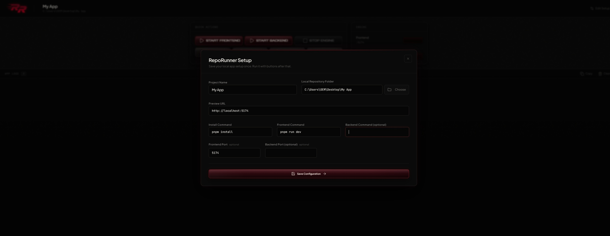
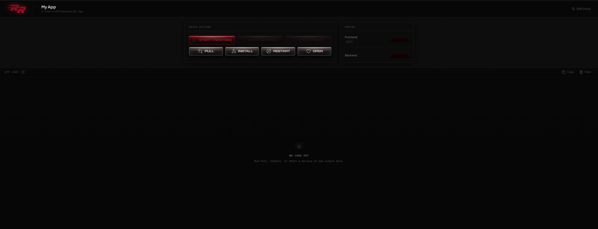
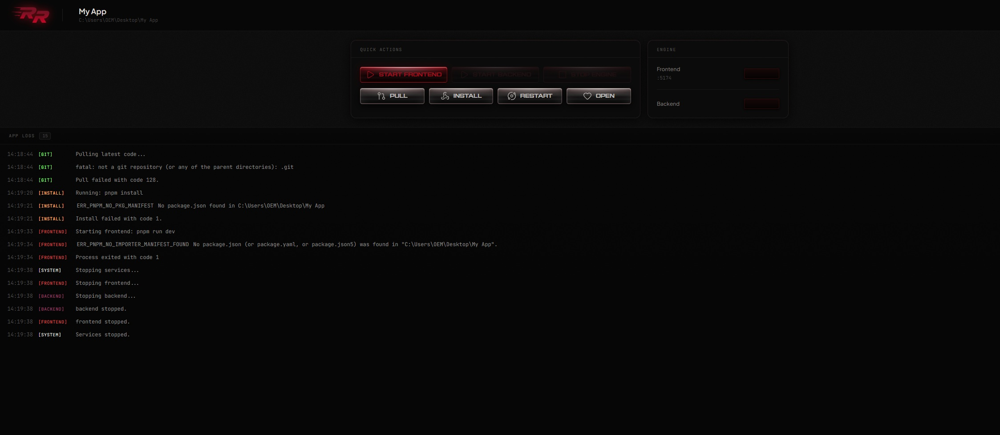

# RepoRunner

> Import your repo once. Save the run setup once. Then pull, install, start, stop, restart, open preview, and inspect logs with buttons.

RepoRunner is a desktop-style app for AI-assisted builders, vibe coders, and solo founders who want to run local GitHub repos without terminals. Save your project config once, then drive everything from a button panel.

RepoRunner is **not** an IDE, deployment platform, or AI debugging assistant.

## Feedback

Tried RepoRunner? Found a bug or got stuck? Open an issue on GitHub or message [@RepoRunnerApp](https://x.com/RepoRunnerApp) on X.

For setup examples, see this README. For common problems, see [Known setup issues](docs/known-setup-issues.md).

---

## Who it's for

- **AI-assisted builders** who received a repo from Cursor, Replit, Claude, ChatGPT, Codex, or another AI coding tool and need to run it locally.
- **Vibe coders** who want to ship with less setup friction.
- **Solo founders** who want one active repo, one panel, and a simpler local run workflow.
- **Anyone running a local repo** who wants pull, install, start, stop, restart, open preview, and inspect logs in one place.

---

## Current status

RepoRunner v0.1.3 desktop build. The multiple saved repo setup workflow is functional and has passed a local end-to-end smoke test.

RepoRunner is intentionally narrow right now: it keeps up to 5 saved repo setups ready while running one active local app at a time from a desktop control panel.

**Platform:** Windows x64 only. The installer isn't code-signed, so Windows may show a security warning during install. RepoRunner doesn't update itself: download new versions from the GitHub Releases page.

**Not yet released:** Analyze Repo, Suggested Setup, Use in Setup and the Repo Safety Check are on the `main` branch and planned for the next release (v0.1.4). They are **not** in the v0.1.3 download. See [Analyze Repo and suggestions](#analyze-repo-and-suggestions-planned-for-v014).

---

## Features

- Save up to 5 local repo setups in RepoRunner Free: repo paths, commands, ports, and preview URLs
- Select between saved setups from the setup screen
- Only one repo is active/running at a time
- Switching saved setups is safely blocked while services are running
- Deleting a saved setup does not delete files from the computer
- Validate the local repo path before saving setup
- **Pull latest** — runs `git pull` in your repo directory
- **Install** — runs your install command, such as `npm install` or `pnpm install`
- **Start Frontend** — starts your frontend server
- **Start Backend** — starts your backend server when configured
- **Frontend-only support** — skips backend start cleanly when no backend command is configured
- **Stop Engine** — stops frontend and backend services
- **Restart All** — sequentially restarts backend, then frontend
- **Open Preview** — opens your configured preview URL in a browser
- **View live logs** — colored by source: git, install, frontend, backend, and system
- **Copy Logs** — copies full log output to clipboard
- **Clear Logs** — clears the log panel
- **Edit Setup** — add, select, update, or delete saved repo setups

---

## Usage

1. Open the app. The setup modal appears on first launch.
2. Fill in your project details:
   - Project name and local repo folder path
   - Preview URL, such as `http://localhost:3000`
   - Install, frontend, and optional backend commands
   - Frontend and optional backend ports for readiness checks
3. Click **Save Repo Setup**. The dashboard loads.
4. Use Quick Actions:
   - **Pull** to fetch the latest code
   - **Install** to run your install command
   - **Start Frontend / Start Backend** to spin up services
   - **Stop Engine** to kill running services cleanly
   - **Restart** to run a full stop-and-start cycle
   - **Open** to launch your preview URL
5. Watch the log panel for real-time output from each service.
6. Click **Edit Setup** in the header to update the active setup or add, select, and delete saved repo setups.
7. Click **Add new repo** to open a blank setup form. Stop running services before switching saved setups.
8. RepoRunner remembers the selected saved setup between restarts.

## Analyze Repo and suggestions (planned for v0.1.4)

These features are on `main` and planned for v0.1.4. They are not in the v0.1.3 download.

The flow on the setup screen is:

**Analyze Repo** → **Suggested Setup** → **Use in Setup…** → review → **Apply to Setup** or **Cancel** → edit if you like → **Save Repo Setup** (or **Update Repo Setup**)

Nothing in this flow runs a command, installs anything, changes your repository files or saves your setup. Install and Start stay manual: you press those buttons yourself, after saving.

### Analyze Repo

Choose the local repo folder, then click **Analyze Repo**. RepoRunner reads the project's files on your computer, read-only, and shows:

- package managers and lockfiles, workspace setup, Node version files and environment file names (never their contents)
- each `package.json` it found, with its scripts and dependency names
- warnings, such as a `package.json` that isn't valid JSON

Nothing is sent anywhere. The scan has size, depth and time limits so very large repositories can't stall the app. When a limit is reached the results are marked **Partial results** and say what wasn't examined; a scan that is cancelled or runs out of time is marked **Analysis cancelled** or **Analysis timed out**. Incomplete results are never presented as complete.

### Suggested Setup

From the analysis, RepoRunner suggests install, development and start commands for the projects it recognizes, such as Vite (React, Vue, Svelte), Next.js, Nuxt, Remix, Astro, SvelteKit, Angular, Express, Fastify and NestJS apps, and npm, pnpm, yarn or bun workspaces.

- Each suggestion shows a confidence level (**High**, **Medium** or **Low: weak evidence**) and the evidence it is based on, such as the script and the lockfile.
- Suggestions can be missing or uncertain. If the analysis didn't finish, none are rated High.
- Suggested commands have not been run, tested or security-checked.
- Suggestions for nested packages and for orchestration tools (such as Turborepo or Nx) are shown for information only.

### Use in Setup

**Use in Setup…** is offered only for an install, development or start command from the repository's root `package.json`, with a recognized package manager (npm, pnpm, yarn or bun). It can fill only the **Install Command** or the **Frontend Command** field.

1. Click **Use in Setup…** on a suggestion. A review opens and shows the field's current value, the proposed command, its confidence and evidence.
2. **Cancel** closes the review and leaves the form unchanged.
3. **Apply to Setup** puts the command into that one field of the form. It doesn't save anything and doesn't run anything.
4. You can still edit the command afterwards.
5. Save explicitly with **Save Repo Setup** (or **Update Repo Setup**). Until then, nothing has changed in your saved setups.

If the folder changes, a new analysis starts, or you switch saved setups while a review is open, the review closes and nothing is applied.

### Repo Safety Check

The Repo Safety Check appears in the analysis results, above Suggested Setup. It looks for warning signs in the `package.json` script commands the analysis read, and reports each one with its concern level (**Notice**, **Caution** or **Warning**), the package and script it was found in, an excerpt of the command, an explanation and a suggested action.

It checks for five kinds of warning signs:

1. **Runs during install:** scripts that run automatically when dependencies are installed (`preinstall`, `install`, `postinstall`, `prepare`). These are common and usually harmless (Notice).
2. **Downloads and runs code:** for example, piping a download straight into a shell (Warning).
3. **Runs an encoded or hidden command:** for example, an encoded PowerShell command or code built at run time (Warning).
4. **Deletes files outside the project:** recursive deletion of a drive root, a home or user folder, a system folder, or a folder above the project (Warning).
5. **Refers to a credential location:** recognizable paths such as SSH keys or cloud credential files (Caution).

The results say one of: **Things worth reviewing**, **No obvious warning signs found in inspected scripts**, **Safety Check incomplete** or **Safety Check unavailable**.

**What it doesn't do.** The Safety Check is an advisory hint, not a malware scan or a security review:

- It only inspects `package.json` script text. Files those scripts run or refer to aren't opened.
- Dependencies' own install scripts aren't inspected.
- Commands are read with a simplified shell reading. Conditionals, loops, variables and functions aren't interpreted, so warning signs inside them can be missed ([issue #82](https://github.com/BoogieDowns/RepoRunner/issues/82)).
- If the analysis was partial, or a command was shortened or changed for display, the check could only look at what was shown, and it says so.
- "No obvious warning signs" doesn't mean the repository is safe.
- Findings never block anything. Whether to install or run a project is always your decision.

## Example setup recipes

These examples show the kind of commands you can save in RepoRunner. Use the commands that match your own project.

### Vite / React app

Use this for many frontend-only React, Vite, or similar projects.

**Repo path**

`C:\Users\YourName\Desktop\MyViteApp`

**Install command**

`npm.cmd install`

**Frontend command**

`npm.cmd run dev`

**Frontend port**

`5173`

**Preview URL**

`http://localhost:5173`

Leave the backend command and backend port empty.

### Next.js app

Use this for a standard Next.js project.

**Install command**

`npm.cmd install`

**Frontend command**

`npm.cmd run dev`

**Frontend port**

`3000`

**Preview URL**

`http://localhost:3000`

Leave the backend command and backend port empty unless your repo starts a separate backend service.

### pnpm workspace or monorepo app

Use this when your repo has multiple apps or packages and the app lives inside a subfolder.

**Repo path**

`C:\Users\YourName\Desktop\MyMonorepo`

**Install command**

`pnpm.cmd install`

**Frontend command**

`cd apps\web && pnpm.cmd run dev`

**Frontend port**

`3000`

**Preview URL**

`http://localhost:3000`

Change `apps\web` to the folder that contains your actual frontend app.

### Frontend + backend repo

Use this when your project has a frontend and a separate backend service.

**Install command**

`pnpm.cmd install`

**Frontend command**

`cd apps\web && pnpm.cmd run dev`

**Frontend port**

`3000`

**Backend command**

`cd apps\api && pnpm.cmd run dev`

**Backend port**

`4000`

**Preview URL**

`http://localhost:3000`

Make sure both services can already run locally from the command line before saving them in RepoRunner.

## Setup notes

On Windows, RepoRunner runs each saved command through `cmd.exe`, so both plain and `.cmd` forms work in setup fields:

    npm install          or   npm.cmd install
    pnpm run dev         or   pnpm.cmd run dev

Suggested Setup proposes the plain form (such as `npm run dev`). The `.cmd` form matters when a command goes through PowerShell, for example when you test it in a PowerShell terminal or start your own command with `powershell`. See [Known setup issues](docs/known-setup-issues.md#npm-npmcmd-and-powershell-on-windows).

For monorepos and workspaces, use the repo/workspace root as the repo path. If the app lives in a subfolder, use `cd` inside the command:

    cd artifacts\my-app && pnpm.cmd run dev

For common setup problems, see [Known setup issues](docs/known-setup-issues.md).

---

## Screenshots

**Setup screen** — configure your project once



**Dashboard** — Quick Actions, Engine panel, and log output





---

## Tech stack

| Layer | Technology |
|---|---|
| UI | React + Vite + TypeScript |
| Styling | Tailwind CSS v4 + shadcn/ui |
| Desktop | Electron |
| Forms | React state + Zod validation |
| Fonts | Plus Jakarta Sans + JetBrains Mono |
| Process management | Node.js child processes + `tree-kill` |
| Port detection | `tcp-port-used` |
| Config storage | Electron `app.getPath("userData")` |
| Web preview | Browser mock via `window.repoRunner` |
| CI | GitHub Actions |

---

## Local development

### Prerequisites

- Node.js 22 (the version CI uses)
- pnpm 10 (the version CI uses; the lockfile needs pnpm 9 or newer)

### Install dependencies

```bash
pnpm install
```

